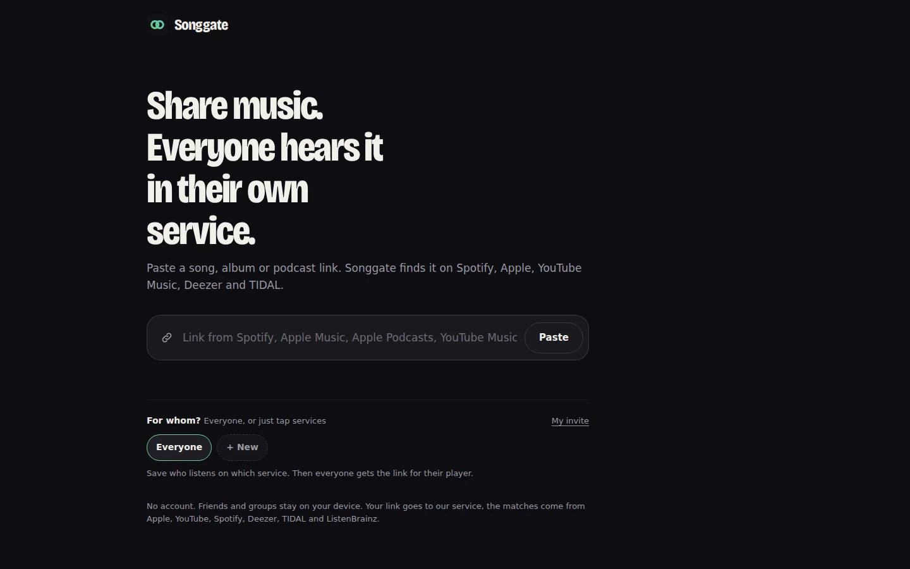

# Songgate

One link, everyone listens in their own service. Songgate takes a link to a song, album or podcast and finds it on Spotify, Apple Music, YouTube Music, Deezer and TIDAL, with a search link for Amazon Music. No sign-up; friends and groups stay on your device.

**Live:** [songgate.app](https://songgate.app) · iOS (App Store, TestFlight) and Android (Google Play) apps with a share extension.



## What's inside

- `apps/web`: SvelteKit web app
- `apps/api`: Hono API that matches songs, albums and podcasts across services
- `apps/cli`: `songgate` command line client for the public API
- `apps/mobile`: Flutter app with iOS share extension
- `packages/shared`, `packages/db`: shared texts and logic, Postgres schema (feedback only)

## Development

```sh
cp -n .env.example .env && docker compose up -d
bun install --frozen-lockfile && bun run dev
```

Checks, deploy, conventions and pitfalls are in [AGENTS.md](AGENTS.md).
